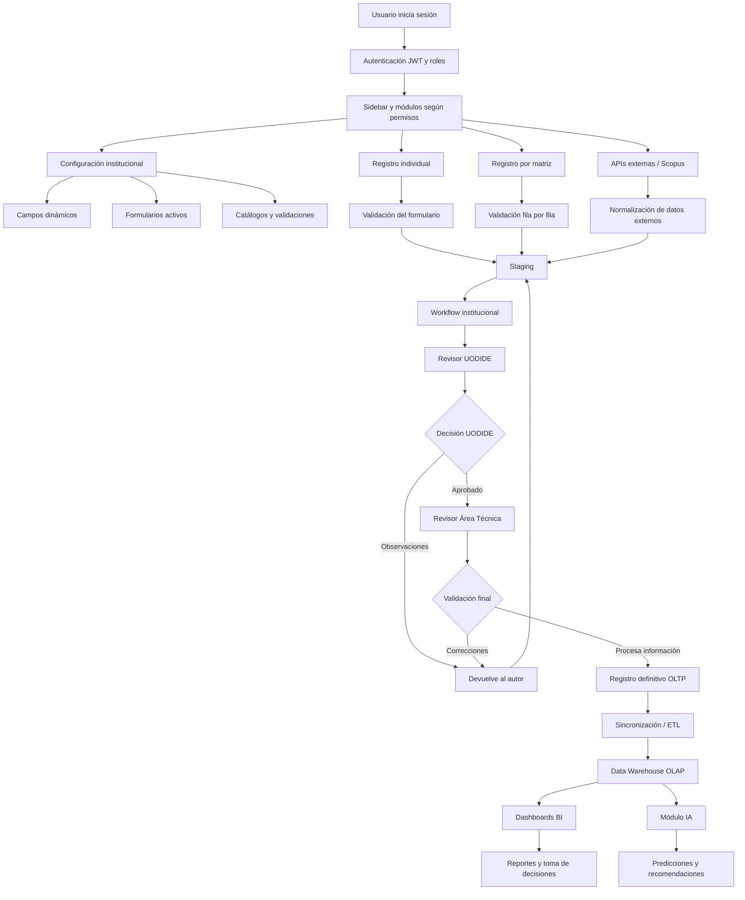
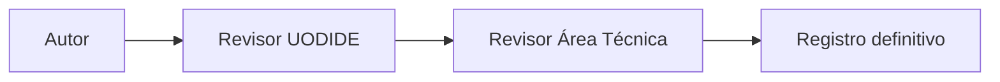
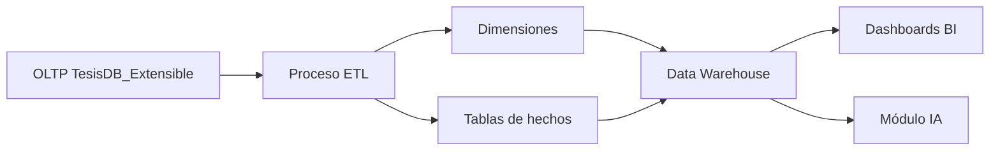

# Flujo funcional integral del sistema de artículos científicos

Documento de estudio para defensa de tesis.

## 1. Visión general del sistema

El sistema desarrollado es una plataforma web modular para la gestión institucional de artículos científicos. Su objetivo principal es permitir que la Dirección de Investigación y Desarrollo gestione el registro, revisión, validación, almacenamiento, análisis y explotación de información científica institucional.

El sistema integra los siguientes bloques funcionales:

- Seguridad, usuarios, roles y permisos.
- Configuración de formularios, campos dinámicos y catálogos.
- Registro individual de artículos.
- Registro masivo mediante matriz.
- Staging de validación.
- Workflow institucional de revisión.
- Integración con APIs externas, principalmente Scopus.
- Ingesta masiva externa.
- Modelo transaccional OLTP.
- Proceso ETL hacia Data Warehouse.
- Modelo analítico OLAP / BI.
- Reporterías, dashboards y exportaciones.
- Módulo de Inteligencia Artificial para predicción y recomendación.
- Auditoría, trazabilidad y métricas operativas.

La idea central del sistema es que la información científica no se registre de forma aislada, sino mediante un flujo controlado, validado y trazable, de manera que los datos finales puedan ser utilizados en reportería institucional, inteligencia de negocio y análisis predictivo.

## 2. Arquitectura funcional general

El sistema está organizado en tres capas principales:

| Capa | Proyecto | Responsabilidad |
|---|---|---|
| Frontend | `tesisproject.frontend` | Interfaz de usuario, formularios, vistas, paneles, validaciones visuales y consumo de API. |
| Backend | `tesisproject.backend` | API REST, reglas de negocio, seguridad, workflow, persistencia, validación, ETL, reportería e IA. |
| Shared | `tesisproject.shared` | DTOs, contratos de datos, mensajes, modelos compartidos y estructuras comunes entre frontend y backend. |

Además, el sistema utiliza dos modelos de datos:

| Modelo | Base lógica | Finalidad |
|---|---|---|
| OLTP | `TesisDB_Extensible` | Registro operativo: artículos, autores, catálogos, formularios, staging, workflow, usuarios y trazabilidad. |
| OLAP / DW | `TesisDW_Extensible` | Análisis institucional: hechos, dimensiones, KPIs, dashboards, reportes e IA. |

## 3. Diagrama general de funcionamiento



## 4. Seguridad, roles y permisos

El sistema inicia con el módulo de autenticación. El usuario ingresa sus credenciales y el backend genera un token JWT. A partir de este token, el frontend identifica los roles y permisos disponibles.

Los roles principales del sistema son:

| Rol | Función dentro del sistema |
|---|---|
| Administrador | Gestiona usuarios, roles, permisos, configuración, formularios, catálogos y acceso general. |
| Autor | Registra artículos, da seguimiento a envíos y corrige observaciones. |
| Revisor UODIDE | Realiza la primera validación institucional del envío. |
| Revisor Área Técnica | Realiza la validación final y procesa el artículo hacia el registro definitivo. |
| Analista / Reportería | Consulta dashboards, indicadores, reportes y resultados analíticos. |
| Usuarios con permisos específicos | Pueden recibir permisos puntuales como registrar, revisar, importar, usar APIs externas o consultar IA. |

El sistema no depende únicamente del nombre del rol, sino de permisos asignables. Esto permite que, si la institución cambia el flujo, el administrador pueda habilitar o restringir acciones sin modificar el código.

Ejemplo:

- Un autor puede tener permiso para registrar artículos.
- Si la institución decide que el autor ya no registre, se le retira ese permiso.
- Si un analista o secretaria debe registrar temporalmente, se le asigna el permiso correspondiente.

## 5. Módulo de configuración

El módulo de configuración es una de las bases funcionales del sistema. Permite administrar los elementos que definen cómo se capturan los datos.

Incluye:

- Campos del sistema.
- Campos dinámicos.
- Formularios activos.
- Catálogos.
- Opciones de campos.
- Reglas de validación.
- Campos visibles, requeridos y editables.
- Mensajes de ayuda y mensajes de error.

### 5.1 Campos dinámicos

Los campos dinámicos permiten que el sistema sea extensible. Si la institución necesita registrar un nuevo dato, el administrador puede crear un campo sin requerir desarrollo de código.

Cada campo puede definir:

- Nombre visible.
- Clave interna.
- Tipo de dato.
- Longitud máxima.
- Si es activo.
- Si es visible.
- Si es requerido.
- Si es editable.
- Regla de validación.
- Mensaje de ayuda.
- Mensaje de error.

### 5.2 Formularios activos

El sistema trabaja con formularios configurables. El formulario activo es el que se utiliza en los registros individuales, matrices y procesos de validación.

Cuando no existe un formulario activo, el sistema debe informar al usuario que el registro no está disponible temporalmente. Esto evita capturar información incompleta o sin estructura institucional.

### 5.3 Catálogos

Los catálogos controlan valores reutilizables como facultades, líneas de investigación, estados, indexaciones, cuartiles, tipos de participante y otros elementos del modelo.

Su función es evitar escritura libre en campos críticos, reduciendo errores como variaciones de texto, duplicidades o valores inválidos.

## 6. Registro individual de artículos

El registro individual permite que un usuario autorizado capture un artículo científico desde un formulario guiado.

Flujo:

1. El usuario ingresa al módulo de registro.
2. El sistema carga el formulario activo.
3. El usuario llena los datos del artículo.
4. El usuario agrega participantes.
5. El sistema valida campos obligatorios, formatos y reglas configuradas.
6. Si hay errores, marca los campos en rojo y muestra mensajes entendibles.
7. Si hay campos opcionales incompletos, puede advertir al usuario antes de enviar.
8. Si la información es correcta, se envía a revisión.
9. El registro entra al staging y al workflow.

Validaciones importantes:

- DOI con longitud controlada.
- Correos con longitud y formato.
- Identificación numérica de diez dígitos.
- Fechas no futuras.
- Número de páginas numérico y dentro del límite permitido.
- Cuartil como lista controlada.
- Participación como Autor o Coautor.
- Al menos un participante obligatorio.
- Orden de autores limitado por la cantidad real de participantes.

## 7. Registro masivo mediante matriz

La matriz de registro permite capturar varios artículos en una estructura tabular.

Su finalidad es facilitar cargas por lote cuando el usuario tiene varios artículos para registrar.

Características:

- Usa la misma lógica de validación del registro individual.
- Valida fila por fila.
- Marca errores por celda.
- Permite varios autores por artículo.
- Permite corregir datos antes de enviar.
- Puede generar lotes para revisión.
- Respeta los campos definidos en el formulario activo.

Flujo:

1. El usuario abre la matriz.
2. El sistema toma como referencia el formulario activo.
3. El usuario captura filas de artículos.
4. El sistema valida cada fila.
5. Las filas válidas quedan listas para enviar.
6. Las filas con errores se mantienen en corrección.
7. El lote se envía a revisión.
8. El lote entra al staging y workflow.

## 8. Staging de validación

El staging es una zona intermedia entre la captura y el registro definitivo.

Su función es evitar que datos incompletos, duplicados o inconsistentes lleguen directamente al modelo principal.

En staging se validan:

- Campos requeridos.
- Tipos de dato.
- Longitudes.
- Catálogos.
- DOI duplicados.
- Datos de revista.
- Participantes.
- Reglas de consistencia.
- Estructura mínima del lote.
- Observaciones del workflow.

El staging es utilizado por:

- Registro individual.
- Matriz de registro.
- Correcciones del autor.
- Revisión UODIDE.
- Revisión Área Técnica.
- Ingesta externa.

## 9. Workflow institucional

El workflow representa el proceso institucional de revisión del artículo antes de registrarlo definitivamente.

Flujo principal:



También permite un flujo alternativo:


### 9.1 Autor

El autor puede:

- Registrar artículos.
- Enviar a revisión.
- Consultar seguimiento.
- Ver observaciones.
- Corregir registros devueltos.
- Reenviar correcciones.
- Eliminar envíos devueltos si corresponde.

### 9.2 Revisor UODIDE

UODIDE puede:

- Ver envíos pendientes.
- Tomar o no tomar un caso.
- Revisar información del staging.
- Enviar observaciones al autor.
- Validar el lote.
- Enviar el caso al Área Técnica.

Si UODIDE no toma el caso, el registro vuelve al autor con observación.

### 9.3 Revisor Área Técnica

Área Técnica puede:

- Realizar la validación final.
- Corregir observaciones si corresponde.
- Devolver al autor.
- Devolver a UODIDE.
- Procesar la información.
- Culminar el registro definitivo.

Este rol es el encargado de enviar la información validada al modelo OLTP final.

## 10. Listado de artículos

El listado de artículos permite visualizar los registros definitivos existentes.

Su función no es iniciar el workflow, sino consultar y revisar la información ya almacenada.

Incluye:

- Vista de tabla.
- Vista de tarjetas.
- Filtros.
- Paginación.
- Modal de detalle.
- Visualización de datos dinámicos.
- Información de autores, revista, año, DOI, indexación y estado.

Este módulo es importante porque actúa como una vista operativa del repositorio final de artículos.

## 11. APIs externas e ingesta masiva

El sistema permite consultar fuentes externas como Scopus para recuperar información científica institucional.

La integración externa tiene dos niveles:

| Nivel | Función |
|---|---|
| Consulta externa | Buscar artículos en proveedores como Scopus. |
| Ingesta masiva | Tomar grandes volúmenes de datos y enviarlos al modelo interno. |

La ingesta masiva está pensada para manejar miles de registros.

Flujo:

1. El usuario autorizado consulta información externa.
2. El sistema recupera artículos.
3. Se filtran registros institucionales, por ejemplo por afiliación Universidad Técnica de Ambato.
4. Se normalizan campos.
5. Se comparan DOI existentes.
6. Se separan artículos nuevos y duplicados.
7. Los artículos nuevos se registran o pasan por staging según la configuración.
8. El sistema informa cuántos registros fueron procesados, nuevos, duplicados o descartados.

Esta funcionalidad alimenta el modelo de datos para reportería histórica y análisis institucional.

## 12. Modelo OLTP

El modelo OLTP almacena la operación diaria del sistema.

Entidades principales:

- `Articles`
- `ArticleParticipants`
- `ArticleIndexings`
- `Venues`
- `VenueMetrics`
- `FieldCatalog`
- `DynamicFieldValues`
- `FormDefinitions`
- `FormFields`
- `ImportBatch`
- `ImportBatchRow`
- `ImportBatchRowValue`
- `WorkflowInstance`
- `WorkflowStageInstance`
- `WorkflowActionLog`
- `RegistrationMatrix`
- `RegistrationMatrixRow`
- `RegistrationMatrixCell`
- `ReportingPerformanceMetrics`
- `IntelligenceTrainingRuns`
- `IntelligenceTrainingAlgorithmMetrics`

Este modelo prioriza integridad, trazabilidad y validación operativa.

## 13. ETL y Data Warehouse

Una vez que los artículos están registrados en el OLTP, el sistema actualiza la reportería mediante procesos ETL.

El ETL transforma la información operacional en un modelo analítico.

Flujo:



Tablas de hechos principales:

- `FactArticlePublication`
- `FactArticleIndexing`
- `FactVenueMetricYear`
- `FactArticleAuthor`

Dimensiones principales:

- `DimDate`
- `DimArticle`
- `DimAuthor`
- `DimVenue`
- `DimField`
- `DimResearchLine`
- `DimPublicationStatus`
- `DimIndexingSource`
- `DimAcademicTerm`
- `DimProject`

El Data Warehouse permite consultar información histórica por año, fecha de publicación, autor, facultad, línea de investigación, revista, indexación y estado.

## 14. Reporterías y BI

El módulo de reportería consume el Data Warehouse y presenta indicadores institucionales.

KPIs principales:

- Total de artículos registrados.
- Producción científica por año.
- Producción por facultad.
- Producción por línea de investigación.
- Producción por campo académico.
- Artículos por revista.
- Artículos por indexación.
- Distribución por cuartil.
- Producción por autor y coautor.
- Participación institucional.
- Acceso abierto.
- Calidad y completitud de datos.
- Tiempos de reportería.
- Tiempos de flujo y revisión.

La reportería sirve para:

- Identificar áreas con mayor producción científica.
- Analizar evolución histórica.
- Evaluar desempeño institucional.
- Detectar concentración de producción.
- Priorizar líneas de investigación.
- Preparar informes para autoridades.
- Exportar datos para Power BI, Tableau o análisis externo.

## 15. Módulo de Inteligencia Artificial

El módulo de IA utiliza la información histórica consolidada en el Data Warehouse.

Sus funciones principales son:

- Predicción de producción científica.
- Recomendaciones institucionales.
- Evaluación de preparación de datos para IA.
- Apoyo a la toma de decisiones.

### 15.1 Predicción

El sistema analiza series históricas de producción científica y estima tendencias futuras.

Modelos considerados:

- Persistencia del último valor.
- Promedio móvil de tres periodos.
- Regresión lineal temporal.
- ForecastBySsa de ML.NET.

El sistema evalúa los modelos mediante métricas de error:

- MAE: error absoluto medio.
- RMSE: raíz del error cuadrático medio.
- MAPE: error porcentual absoluto medio.

Fórmulas:

```text
MAE = Σ |Real - Predicho| / n

RMSE = sqrt(Σ(Real - Predicho)^2 / n)

MAPE = (Σ |(Real - Predicho) / Real| / n) × 100
```

El mejor modelo es el que presenta menor error y mayor estabilidad para los datos disponibles.

### 15.2 Recomendaciones

El sistema genera recomendaciones basadas en:

- Campos académicos con mayor producción.
- Líneas de investigación activas.
- Facultades con concentración de producción.
- Tendencias históricas.
- Cobertura de indexación.
- Calidad de datos.
- Señales del workflow.

Ejemplos de recomendaciones:

- Reforzar líneas de investigación con crecimiento sostenido.
- Revisar áreas con baja producción.
- Mejorar completitud de datos en registros científicos.
- Priorizar revistas o indexaciones con mayor impacto.
- Identificar facultades que requieren acompañamiento.

### 15.3 Indicador de preparación IA

El sistema calcula un indicador ponderado de preparación de datos:

```text
OverallScore =
(Volumen × 0.30) +
(Trazabilidad de autores × 0.22) +
(Cobertura de indexación × 0.20) +
(Calidad de carga × 0.14) +
(Señales de workflow × 0.14)
```

Este indicador permite saber si los datos son suficientes y confiables para análisis predictivo.

## 16. Auditoría y trazabilidad

El sistema mantiene trazabilidad de acciones importantes.

Se registra:

- Usuario que realiza acciones.
- Cambios en workflow.
- Observaciones.
- Estados de lote.
- Validaciones.
- Procesamientos.
- Métricas de reportería.
- Historial de entrenamiento IA.

Esto permite explicar en defensa que el sistema no solo almacena datos, sino que también controla el proceso institucional.

## 17. Interacción entre módulos

| Módulo origen | Módulo destino | Interacción |
|---|---|---|
| Seguridad | Todos los módulos | Controla acceso por roles y permisos. |
| Configuración | Registro y matriz | Define campos, formularios y validaciones. |
| Registro individual | Staging | Envía artículo para validación. |
| Matriz | Staging | Envía lotes de artículos. |
| APIs externas | Ingesta / staging | Alimenta datos externos normalizados. |
| Staging | Workflow | Controla datos antes de revisión. |
| Workflow | OLTP | Permite registro definitivo tras aprobación. |
| OLTP | ETL | Fuente de datos operativos. |
| ETL | Data Warehouse | Transforma datos para análisis. |
| Data Warehouse | Reportería | Provee KPIs y dashboards. |
| Data Warehouse | IA | Provee datos históricos para predicción y recomendación. |
| Auditoría | Administración | Permite seguimiento de acciones y métricas. |

## 18. Flujo completo para explicar en defensa

El flujo completo puede explicarse así:

1. El usuario ingresa al sistema con credenciales.
2. El sistema identifica su rol y permisos.
3. El administrador configura campos, formularios, catálogos y reglas de validación.
4. El usuario autorizado registra artículos de forma individual o mediante matriz.
5. El sistema valida la información antes de enviarla.
6. Los registros ingresan a una zona de staging.
7. El workflow institucional inicia con UODIDE.
8. UODIDE toma el caso, revisa y decide si devuelve o aprueba.
9. Si hay observaciones, el autor corrige y reenvía.
10. Si UODIDE aprueba, el caso pasa al Área Técnica.
11. Área Técnica valida, corrige o devuelve si es necesario.
12. Si la información es correcta, Área Técnica procesa el registro definitivo.
13. Los artículos quedan almacenados en el modelo OLTP.
14. El ETL sincroniza los datos hacia el Data Warehouse.
15. La reportería muestra KPIs, gráficos y reportes institucionales.
16. El módulo de IA usa los datos históricos para predicción y recomendación.
17. La institución utiliza los resultados para toma de decisiones.

## 19. Mensaje clave para la defensa

El sistema no es solo un formulario de registro de artículos. Es una plataforma institucional que integra captura de datos, validación, workflow, trazabilidad, almacenamiento transaccional, análisis BI e Inteligencia Artificial.

Su principal aporte es convertir el registro científico institucional en un proceso controlado, configurable y analítico, permitiendo que la información registrada sea útil para reportería, seguimiento, toma de decisiones y análisis predictivo.

## 20. Resumen ejecutivo

El sistema desarrollado permite gestionar de forma integral la producción científica institucional. Inicia con autenticación y control de permisos, continúa con formularios dinámicos y registros individuales o masivos, valida la información mediante staging, la somete a un workflow institucional de revisión UODIDE y Área Técnica, almacena los datos aprobados en un modelo OLTP, los transforma mediante ETL hacia un Data Warehouse y finalmente los explota mediante dashboards BI e Inteligencia Artificial.

La arquitectura modular y configurable permite adaptarse a cambios institucionales, incorporar nuevos campos sin reprogramar formularios, controlar la calidad de datos, integrar fuentes externas como Scopus y generar información útil para la toma de decisiones.
